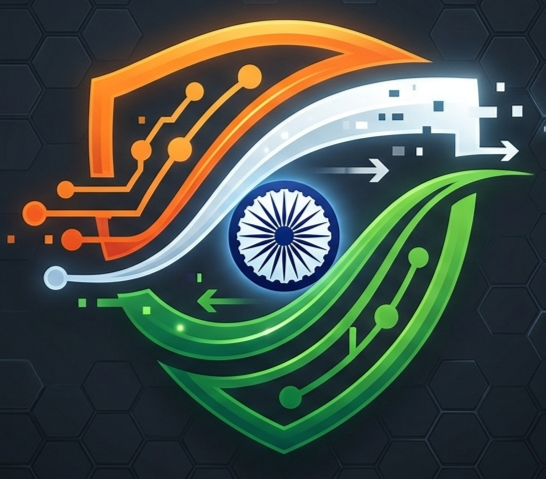
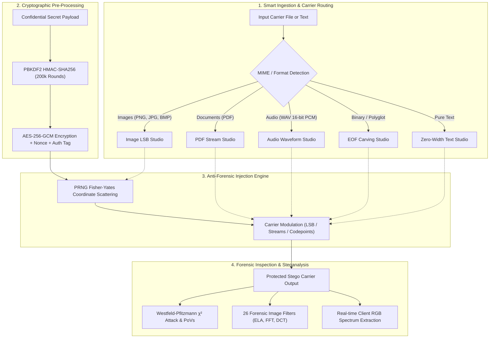

<p align="center">
  
</p>

<h1 align="center">🛡️ STEGNOFLOW</h1>
<p align="center">
  <strong>Dual-Steganography Carrier Studio & Forensic Steganalysis Defense Suite</strong><br>
  <em>Military-Grade AES-256-GCM Encrypted Embedding &bull; PRNG Scattering &bull; Real-Time &chi;&sup2; Statistical Attack Detection</em>
</p>

<p align="center">
  <a href="https://github.com/JaiServanaBhava/StegnoFlow">
    
  </a>
  <a href="https://github.com/JaiServanaBhava/StegnoFlow">
    
  </a>
  <a href="https://github.com/JaiServanaBhava/StegnoFlow">
    
  </a>
  <a href="https://github.com/JaiServanaBhava/StegnoFlow">
    
  </a>
</p>

<p align="center">
  <a href="https://github.com/JaiServanaBhava/StegnoFlow/stargazers">
    
  </a>
  <a href="https://github.com/JaiServanaBhava/StegnoFlow/network/members">
    
  </a>
  <a href="https://github.com/JaiServanaBhava/StegnoFlow/watchers">
    
  </a>
</p>

---

## 📑 Table of Contents
- [Executive Overview](#-executive-overview)
- [System Architecture](#-system-architecture)
- [Dual-Engine Carrier Studio](#-dual-engine-carrier-studio)
- [Statistical Steganalysis & Chi-Square Lab](#-statistical-steganalysis--chi-square-lab)
- [26+ Forensic Filters Gallery](#-26-forensic-filters-gallery)
- [Zero-Width Invisible Text Stego](#-zero-width-invisible-text-stego)
- [3D Interactive WebGL Interface](#-3d-interactive-webgl-interface)
- [Quick Start & Installation](#-quick-start--installation)
- [Verification & Automated Test Suite](#-verification--automated-test-suite)
- [Academic Viva & Syllabus Alignment](#-academic-viva--syllabus-alignment)
- [License](#-license)

---

## 🎯 Executive Overview

**StegnoFlow** is a next-generation cyber defense and intelligence steganography platform engineered for security researchers, forensic analysts, and defense personnel. It bridges the gap between **offensive payload concealment** and **defensive statistical detection**.

Traditional steganography tools merely overwrite sequential bits, leaving distinct statistical artifacts that naive detectors easily spot. StegnoFlow implements **dual-layer protection**:
1. **Cryptographic Hardening**: Payloads are sealed via **AES-256-GCM authenticated encryption** with PBKDF2 (200,000 rounds) key derivation, ephemeral 96-bit nonces, and 128-bit authentication tags.
2. **Deterministic PRNG Spatial Scattering**: Bit distribution is scrambled pseudo-randomly across 2D/3D pixel matrices using a cryptographic seed, defeating sequential strip scans.
3. **Multi-Carrier Modalities**: Supports Lossless Images (PNG/BMP), PDF Document Stream Infiltration, 16-bit PCM Audio WAV, Polyglot Executable/Archive Carving, and Invisible Unicode Zero-Width Text.
4. **Westfeld-Pfitzmann &chi;&sup2; Attack Suite**: Real-time evaluation of Pairs of Values (PoVs $2k$ vs $2k+1$) with continuous $p$-value trajectory curves and live RGB client spectrum extraction.

---

## 🏗️ System Architecture

### 1. Dual-Core Carrier Pipeline



### 2. Chi-Square ($\chi^2$) Steganalysis Mathematical Model

StegnoFlow measures the theoretical frequency equalization between paired pixel values:

$$\chi^2 = \sum_{k=1}^{128} \frac{(y_{2k} - y_{2k}^*)^2}{y_{2k}^*} \quad \text{where} \quad y_{2k}^* = \frac{y_{2k} + y_{2k+1}}{2}$$

When non-stego images are analyzed, naturally asymmetric values deviate significantly ($p \approx 0$). In contrast, LSB-embedded images exhibit paired equalization, triggering immediate statistical anomaly alerts ($p \to 1.0$).

---

## 💎 Dual-Engine Carrier Studio

| Carrier Medium | Technique | Cryptography | Visual / Audio Degradation |
| :--- | :--- | :--- | :--- |
| **Lossless Image (PNG / BMP)** | 1-4 Bit LSB + PRNG Permutation Scattering | AES-256-GCM AEAD | **PSNR > 68 dB** (Zero Human Perception) |
| **PDF Document** | Stream Object Infiltration & Structure Preservation | AES-256-GCM AEAD | **100% Compliant** (Opens in Adobe Reader) |
| **Audio WAV** | 16-bit PCM Sample LSB Encoding | AES-256-GCM AEAD | **SNR > 90 dB** (Zero Audible Noise) |
| **Polyglot File** | Marker Injection (`\xFF\xD9` JPEG / `IEND` PNG) | Metadata Sanitizer | **Lossless Dual Execution** (Image + ZIP/EXE) |
| **Invisible Plaintext** | Zero-Width Unicode Codepoints (`\u200B`, `\u200C`) | AES-256-GCM AEAD | **100% Invisible** (Copy-paste across WhatsApp/Email) |

---

## 🔬 Statistical Steganalysis & Chi-Square Lab

The Steganalysis suite equips defense analysts with laboratory-grade forensic tools:
- **Westfeld & Pfitzmann $\chi^2$ Trajectory Curve**: Scans carriers in 5% incremental windows to pinpoint exact embedding depth.
- **Pairs of Values (PoV) Differential Histogram**: Compares frequencies of paired bins ($2k$ vs $2k+1$) to reveal artificial equalization.
- **Client-Side Live RGB Histogram**: 64-bin per-channel frequency spectrum rendered in real-time via HTML5 Canvas and Chart.js.
- **Ground-Truth Degradation Telemetry**:
  - **PSNR (Peak Signal-to-Noise Ratio)**: Verifies imperceptibility ($> 65\text{ dB}$).
  - **MSE (Mean Squared Error)**: Measures mathematical per-pixel deviation.
  - **SSIM (Structural Similarity Index)**: Measures structural preservation ($> 0.999$).

---

## 🎨 26+ Forensic Filters Gallery

Real-time mathematical and forensic image transforms for anomaly detection:
- **Bit-Plane Slicing**: Bit-Plane 0 (LSB Slicer) to Bit-Plane 7 (MSB Slicer).
- **Error Level Analysis (ELA 90% / 95%)**: Highlights compression rate inconsistencies from localized tampering.
- **Frequency Domain (2D FFT Spectrum)**: Identifies high-frequency periodic grid noise induced by steganographic injection.
- **Discrete Cosine Transform (DCT)**: Visualizes 8x8 block energy distribution.
- **Spatial Gradients**: Laplacian High-Pass, Sobel Edge, Canny Multi-Stage, and False-Color Thermal Mapping.

---

## 📝 Zero-Width Invisible Text Stego

StegnoFlow converts AES-256-GCM ciphertext bytes into a binary stream represented exclusively by invisible Unicode non-printable characters:
- `U+200B` : Zero-Width Space (`0`)
- `U+200C` : Zero-Width Non-Joiner (`1`)
- `U+200D` : Zero-Width Joiner (Delimiter)
- `U+FEFF` : Byte Order Mark (Auth Tag)

The resulting text appears completely standard to human readers, screen readers, and character count counters, allowing transmission across messaging platforms, social media, and restricted channels without triggering DLP filters.

---

## 🌐 3D Interactive WebGL Interface

- **Three.js WebGL Hologram**: Real-time rotating 3D cryptographic core reacting to system state (Idle, Processing, Success, Error).
- **Tactile 3D Buttons**: Multi-layer depth, dynamic neon cyan bevels, and holographic sheen sweeps.
- **Procedural Cyber Audio**: Synthesized Web Audio API procedural sound effects (Key clicks, Success chimes, Error buzzers).
- **Instant Clipboard Paste (Ctrl+V)**: Paste images directly from Snipping Tool or clipboard into the dashboard for instantaneous processing.

---

## 🚀 Quick Start & Installation

### Prerequisites
- Python 3.10+ (Recommended: Python 3.11, 3.12, or 3.13)
- Git

### 1. Clone the Repository
```bash
git clone https://github.com/JaiServanaBhava/StegnoFlow.git
cd StegnoFlow
```

### 2. Create and Activate Virtual Environment
```bash
# Windows (PowerShell)
python -m venv venv
.\venv\Scripts\Activate.ps1

# Linux / macOS
python3 -m venv venv
source venv/bin/activate
```

### 3. Install Dependencies
```bash
pip install -r requirements.txt
```

### 4. Launch Application
```bash
python app.py
```
Open your browser and navigate to:
```
http://127.0.0.1:8000
```

*(Optional Streamlit Academic Viva Mode):*
```bash
streamlit run streamlit_app.py
```

---

## 🧪 Verification & Automated Test Suite

StegnoFlow includes a comprehensive 10-module end-to-end verification suite:

```bash
python test_suite.py
```

### Expected Output:
```
==================================================
🛡️  RUNNING STEGNOFLOW VERIFICATION SUITE
==================================================
[1/7] Testing AES-256-GCM Cryptography...
  -> AES-256-GCM Authenticated Encryption: PASSED
[2/7] Testing Image LSB Steganography & PRNG Scattering...
  -> Image LSB Embedding + Extraction: PASSED (PSNR: 69.39 dB)
[3/7] Testing Steganalysis (Chi-Square & PoVs)...
  -> Chi-Square & Steganalysis Suite: PASSED (Verdict: HIGH PROBABILITY)
[4/7] Testing 26 Forensic & Visual Effects...
  -> All 26 Forensic Filters executed successfully: PASSED
[5/7] Testing Zero-Width Invisible Text Stego...
  -> Zero-Width Invisible Text: PASSED
[6/7] Testing Audio WAV Steganography...
  -> Audio WAV PCM LSB: PASSED
[7/10] Testing Polyglot & EOF File-Carving...
  -> Polyglot File-Carving: PASSED
[8/10] Testing PDF Document Steganography...
  -> PDF Document Steganography: PASSED
[9/10] Testing Synthetic Audio Tone Generator & Metadata Sanitizer...
  -> Synthetic Carrier & Metadata Sanitizer: PASSED
[10/10] Testing Cryptographic Hash Engine & Password Entropy...
  -> Multi-Hash Fingerprinter & Entropy Engine: PASSED
==================================================
🎉 ALL 10/10 STEGNOFLOW CORE MODULES VERIFIED & OPERATIONAL!
==================================================
```

---

## 🎓 Academic Viva & Syllabus Alignment

StegnoFlow fully satisfies and exceeds the requirements for **JNTUK R23 Project 20: Steganography Tool — Hide & Detect Secret Messages**:

| Criterion | JNTUK R23 Specification | StegnoFlow Implementation |
| :--- | :--- | :--- |
| **Project Number** | Project 20 | Dual Steganography & Steganalysis Suite |
| **Syllabus Units** | Cyber Security U2, Python U1-U2 | Cryptography, Image Processing, Statistical Detection |
| **Primary Technique** | LSB Steganography | 1-4 Bit LSB with PRNG Scattering across RGB channels |
| **Detection Method** | Histogram & Anomaly Analysis | Chi-Square Attack, PoV Equalization, ELA, FFT |
| **Carrier Scope** | Images | Lossless Images, PDF, Audio WAV, Polyglots, Zero-Width Text |
| **Encryption Standard** | Symmetric Key | AES-256-GCM with PBKDF2 (200,000 Rounds) |

---

## 📜 License

Distributed under the **MIT License**. See `LICENSE` for more information.

<p align="center">
  <sub>Engineered with precision for advanced cyber intelligence and defense research.</sub>
</p>
