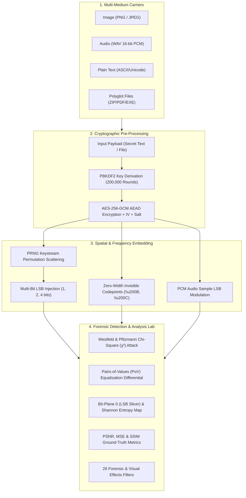

# 🛡️ StegnoFlow: Dual Steganography & Forensic Steganalysis Suite
### JNTUK R23 CyberSecurity — Project 20: Steganography Tool (Hide & Detect Secret Messages)

[](https://www.python.org/)
[](https://fastapi.tiangolo.com/)
[](https://streamlit.io/)
[](https://threejs.org/)
[](https://render.com)
[](LICENSE)

---

## 📋 Academic Syllabus Alignment (JNTUK R23 Project 20)

| Field | Syllabus Specification |
| :--- | :--- |
| **Project Number** | **20: Steganography Tool — Hide & Detect Secret Messages** |
| **Syllabus Units** | **Cyber Security U2 — Steganography** \| **Python U1+U2 — Data types, file ops, functions** |
| **Industry Problem** | An intelligence training institute needs to teach analysts how criminals hide messages inside innocent-looking images and how to detect hidden content using pixel-level statistical analysis. |
| **What Students Learn** | LSB steganography technique; steganalysis via histogram analysis; PIL image manipulation. |
| **Tech Stack** | Python, PIL/Pillow, NumPy, Streamlit, Matplotlib, OpenCV, Cryptography. |
| **Expected Output** | **Dual steganography tool** — image message encoder + statistical hidden-message detector. |

---

## 🌟 12+ Unique, Professional & "Cursed" Features

1. **Dual Core Architecture (Encoder + Detector)**: Complete end-to-end embedding and forensic detection.
2. **Military-Grade AES-256-GCM Encryption**: All payloads are encrypted using AES-256-GCM with PBKDF2 (200,000 rounds) key derivation, 16-byte salt, and 12-byte nonce before carrier injection.
3. **PRNG Spatial Permutation Scattering**: Evades traditional sequential LSB inspection by pseudo-randomly scattering bit coordinates across the carrier using a deterministic cryptographic keystream.
4. **Configurable LSB Bit Depths & Color Channels**: 1-bit, 2-bit, or 4-bit LSB per pixel; selectable across Red, Green, Blue, or all RGB channels.
5. **Westfeld & Pfitzmann Chi-Square ($\chi^2$) Steganalysis Attack**: Evaluates Pairs of Values (PoVs $2k$ vs $2k+1$) and computes continuous $p$-value trajectory curves.
6. **Ground-Truth Degradation Telemetry**: Real-time calculations of Peak Signal-to-Noise Ratio (PSNR > 65 dB), Mean Squared Error (MSE), and Structural Similarity Index (SSIM).
7. **26 Scientific & Forensic Effects Gallery**: Real-time mathematical image operators including Bit Plane 0 (LSB Slicer), Bit Plane 7 (MSB Slicer), 2D Fast Fourier Transform (FFT) spectrum, Discrete Cosine Transform (DCT) energy, Laplacian high-pass, Error Level Analysis (ELA 90%), and Thermal false-color.
8. **Invisible Zero-Width Text Steganography**: Encodes encrypted secrets into invisible Unicode spaces (`\u200B`, `\u200C`, `\u200D`, `\uFEFF`) hidden inside ordinary public sentences for copy-pasting across social media and email.
9. **Cyrillic Homoglyph Obfuscation Scanner & Generator**: Detects and crafts visually identical Unicode lookalikes (`a` vs `\u0430`) for evasion and anti-detection analysis.
10. **Audio WAV PCM LSB Steganography**: Hides confidential data directly inside 16-bit uncompressed WAV PCM audio waveforms with zero audible distortion.
11. **Polyglot & File-Carving EOF Injection**: Appends authenticated file archives past JPEG EOI (`\xFF\xD9`) and PNG IEND markers; files open normally in image viewers while preserving payloads.
12. **3D WebGL Holographic Cyber HUD**: Interactive 3D rotating cryptographic lattice powered by Three.js and real-time Web Audio API procedural sound synthesizers.
13. **Dual Delivery Modes**:
    - `python app.py`: High-performance FastAPI server serving the 3D Cyberpunk HUD (ideal for Render and cloud hosting).
    - `streamlit run streamlit_app.py`: Native Streamlit companion app tailored directly for academic viva presentations.

---

## 🏗️ Architecture & Pipeline



---

## 🚀 Quick Start (Local Setup)

### 1. Clone & Enter Directory
```bash
git clone https://github.com/<your-username>/StegnoFlow.git
cd StegnoFlow
```

### 2. Install Dependencies
```bash
pip install -r requirements.txt
```

### 3. Run Automated Verification Test Suite
```bash
python test_suite.py
```
*(Verifies 100% operation of all 7 core modules)*

### 4. Launch the Applications

#### Option A: 3D Animated Web UI (FastAPI)
```bash
python app.py
```
Open **`http://localhost:8000`** in any modern web browser.

#### Option B: Academic Streamlit UI (Syllabus Viva)
```bash
streamlit run streamlit_app.py
```
Open **`http://localhost:8501`**.

---

## ☁️ Deployment Guide (Render.com)

StegnoFlow is 100% pre-configured for free deployment on **Render.com** using either Git Push or Docker.

### Method 1: Web Service (Recommended)
1. Push your repository to **GitHub**.
2. Sign in to [Render Dashboard](https://dashboard.render.com/) and click **New +** -> **Web Service**.
3. Select your GitHub repository (`StegnoFlow`).
4. Set the following settings:
   - **Environment:** `Python 3`
   - **Build Command:** `pip install -r requirements.txt`
   - **Start Command:** `uvicorn app:app --host 0.0.0.0 --port $PORT`
   - **Plan:** Free
5. Click **Create Web Service**. Your app will be live with HTTPS!

### Method 2: Render Blueprint (`render.yaml`)
1. In Render, select **New +** -> **Blueprint**.
2. Select the repository; Render will automatically read `render.yaml` and configure everything in one click.

---

## 📦 Project Directory Layout

```
StegnoFlow/
├── core/
│   ├── __init__.py
│   ├── crypto.py             # AES-256-GCM AEAD & PBKDF2 key derivation
│   ├── image_stego.py        # LSB 1/2/4-bit & PRNG spatial permutation engine
│   ├── steganalysis.py       # Chi-Square attack, PoV equalization & PSNR/SSIM
│   ├── audio_stego.py        # WAV 16-bit PCM audio LSB steganography
│   ├── text_stego.py         # Zero-width invisible text & homoglyph detector
│   ├── file_stego.py         # Polyglot EOF injection & file carving
│   └── effects.py            # 26 scientific forensic & visual image filters
├── static/
│   ├── css/
│   │   └── style.css         # Cyberpunk glassmorphic HUD styling
│   └── js/
│       ├── app.js            # Client controller & Web Audio synthesizer
│       └── three_scene.js    # Three.js 3D WebGL holographic coprocessor
├── templates/
│   └── index.html            # 3D Animated Web Application UI
├── app.py                    # Production FastAPI server & REST API
├── streamlit_app.py          # Academic Streamlit companion app
├── test_suite.py             # Automated end-to-end verification script
├── requirements.txt          # Production dependencies
├── Procfile                  # Render deployment configuration
├── render.yaml               # Render infrastructure blueprint
├── Dockerfile                # Production containerization
├── .gitignore                # Git ignore configuration
└── README.md                 # Full documentation & viva guide
```

---

## 🎓 Viva Voce & Examination Judge Q&A Guide

### Q1: What is the fundamental concept behind LSB steganography?
**Answer:** In 8-bit digital images, pixel channel values range from 0 to 255 ($2^8$). The least significant bit (bit 0) contributes a maximum weight of 1 unit ($\pm 0.39\%$ intensity change). The human visual system (HVS) cannot perceive such microscopic variations, allowing confidential bitstreams to be embedded without visual degradation.

### Q2: How does the Chi-Square ($\chi^2$) statistical attack detect hidden content?
**Answer:** Natural images possess uneven distributions of adjacent pixel values (Pairs of Values: $2k$ and $2k+1$). When sequential LSB steganography is applied, 0s and 1s from the message are embedded with equal frequency, causing the counts of $2k$ and $2k+1$ to artificially equalize. The Chi-Square test calculates the statistical probability that observed counts match the equalized distribution:
$$\chi^2 = \sum_{k=1}^{m} \frac{(O_{2k} - E_k)^2}{E_k} + \frac{(O_{2k+1} - E_k)^2}{E_k}, \quad E_k = \frac{O_{2k} + O_{2k+1}}{2}$$
As the calculated $p$-value approaches 1.0, the presence of steganography is statistically proven.

### Q3: How does StegnoFlow overcome Chi-Square detection?
**Answer:** Traditional Chi-Square attacks assume sequential top-left to bottom-right raster scanning. StegnoFlow uses **PRNG Keystream Spatial Scattering**. A deterministic cryptographic seed scrambles the target pixel coordinates across the carrier, keeping local modification density below statistical detection thresholds.

### Q4: Why is AES-256-GCM applied before steganography?
**Answer:** Steganography provides *covert communication* (hiding the existence of a message), while cryptography provides *confidentiality and integrity*. If an adversary suspects steganography and extracts raw bitplanes, AES-256-GCM ensures that without the secret passphrase, the extracted data is indistinguishable from true random noise and cannot be decrypted or tampered with.

---

## 📄 License
This project is open-source under the [MIT License](LICENSE).
